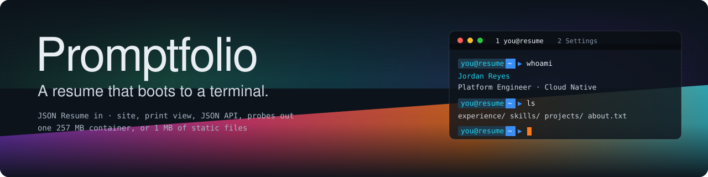
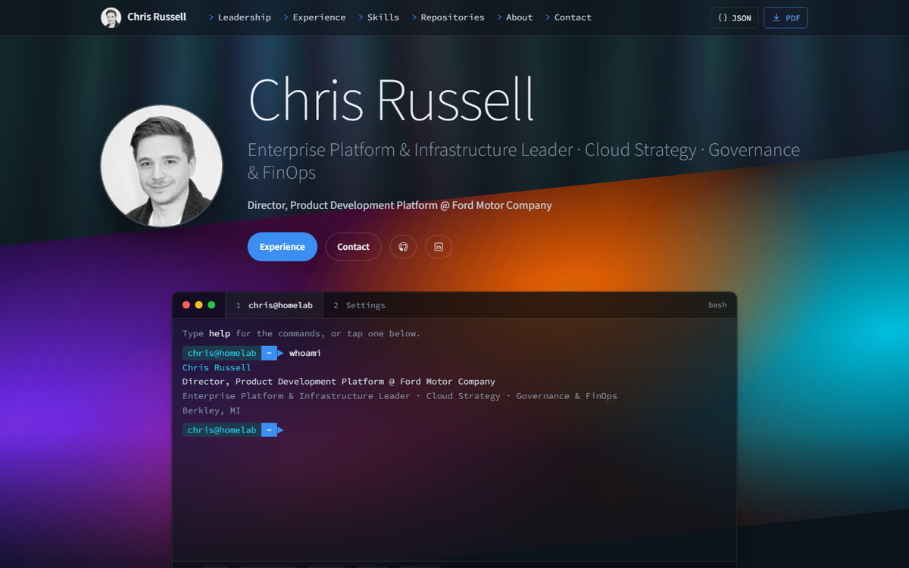
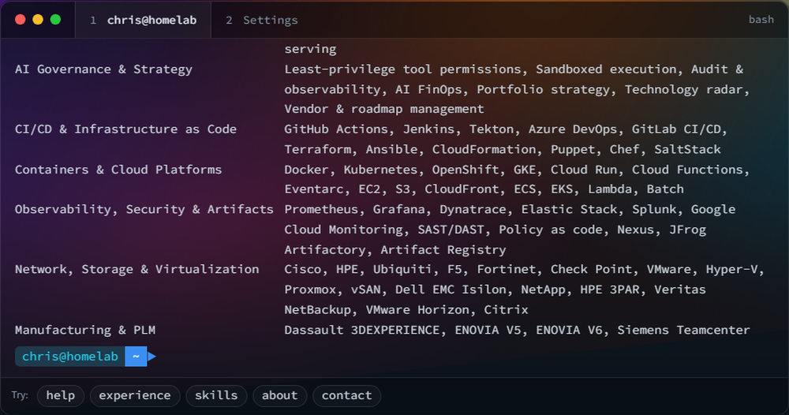
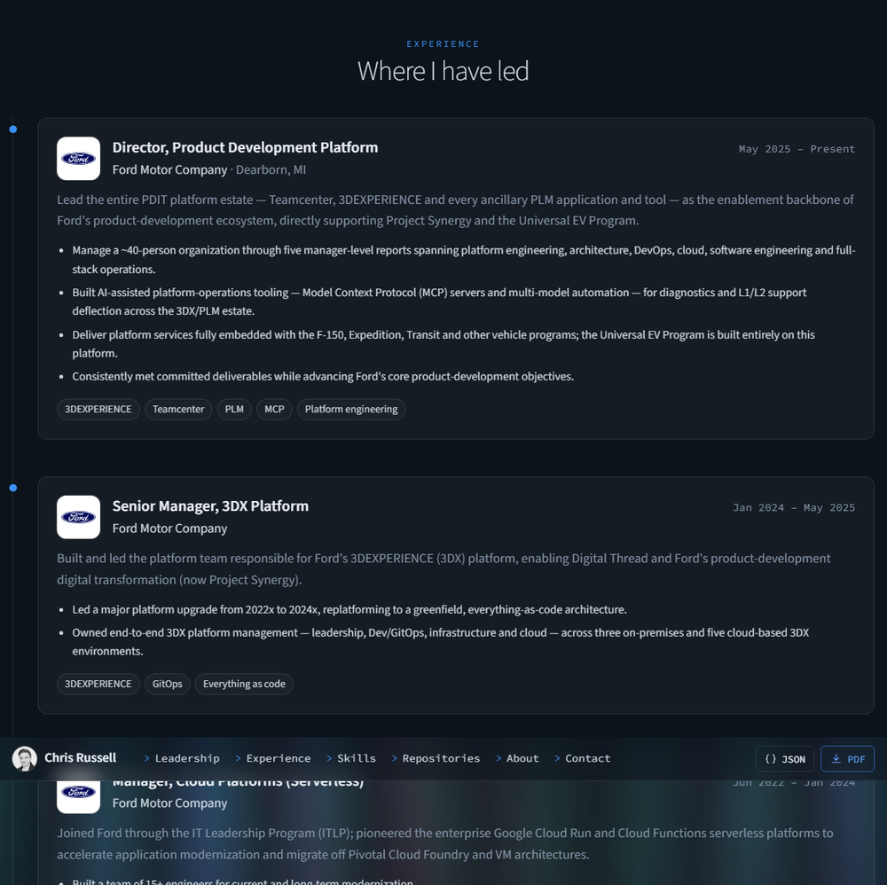
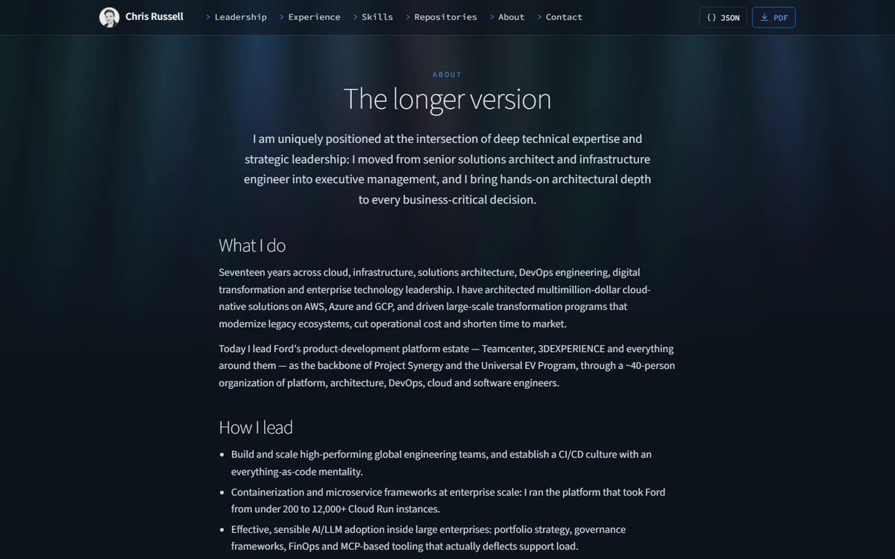
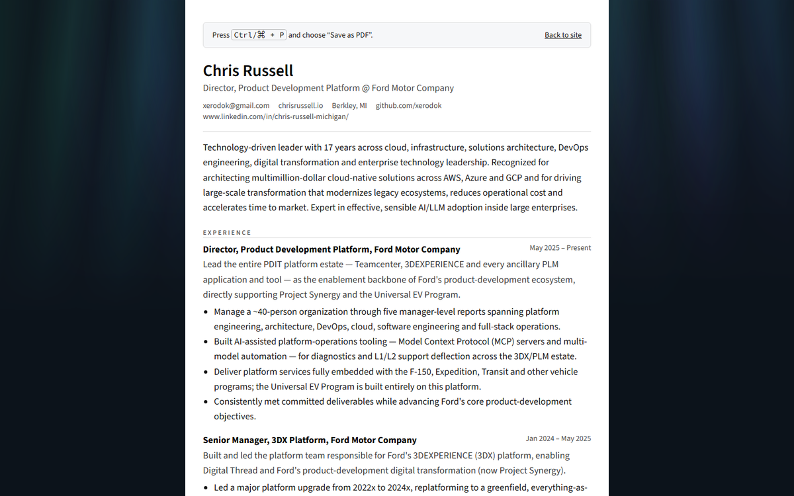
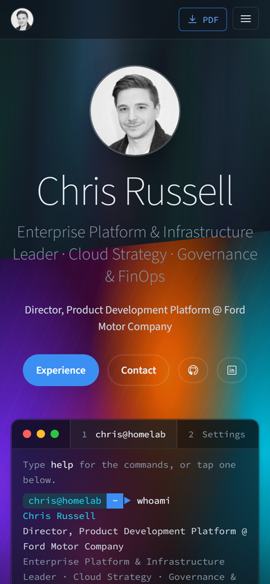

<p align="center">
  
</p>

<p align="center">
  <a href="https://github.com/xerodok/promptfolio/actions/workflows/ci.yml"></a>
  <a href="https://github.com/xerodok/promptfolio/actions/workflows/release.yml"></a>
  <a href="https://github.com/xerodok/promptfolio/pkgs/container/promptfolio"></a>
  
  
  <a href="./LICENSE"></a>
</p>

<p align="center">
  <a href="https://github.com/new?template_name=promptfolio&template_owner=xerodok"><b>Use this template</b></a> ·
  <a href="https://chrisrussell.io">Live example</a> ·
  <a href="docs/CUSTOMIZING.md">Customize</a> ·
  <a href="docs/DEPLOYMENT.md">Deploy</a> ·
  <a href="docs/ARCHITECTURE.md">Architecture</a> ·
  <a href="docs/FAQ.md">FAQ</a>
</p>

---

**One [JSON Resume](https://jsonresume.org/schema) document in.** Out: a
Tabby-inspired site with an interactive `bash`-style terminal, an About page,
a print view for PDF, a JSON API, and health probes — shipped as a signed,
multi-arch, non-root container (~257 MB, ~40 MB RSS) or as ~1 MB of static
files. No database, no secrets, no third-party requests.

> This repository is a **template** by [Chris Russell](https://chrisrussell.io).
> The committed sample persona is fictional. Use the template, drop in your
> resume, and it is yours.

## What it looks like

Screenshots are the author's live site, [chrisrussell.io](https://chrisrussell.io),
built from this template unchanged. The persona committed in `content/` is a
fictional sample.

<p align="center">
  
</p>

<table>
  <tr>
    <td width="50%"></td>
    <td width="50%"></td>
  </tr>
  <tr>
    <td></td>
    <td></td>
  </tr>
</table>

<p align="center">
  
</p>

The terminal is a real little shell: `help`, `whoami`, `experience [n]`,
`skills`, `repos`, `education`, `contact`, `about`, `open <section>`, `json`,
`pdf`, plus `ls`, `cat`, `cd`, `pwd`, `echo`, `date`, `history`, `man`,
`--help`, Tab completion and `&&`/`;` chaining. A Settings tab remembers
per-browser preferences (background animation, boot animation, font size).

## Use this template

1. Click **Use this template** (or fork).
2. Edit `content/resume.json` — standard JSON Resume, nothing invented.
3. Edit `content/site.json` (headings, tagline, stats, cards, nav, logos,
   prompt) and `content/about.json` (the About page). Drop a `photo.jpg` and
   any employer logos into `public/`. Every field is documented in
   [docs/CUSTOMIZING.md](docs/CUSTOMIZING.md).
4. `pnpm install && pnpm dev` → http://localhost:3000 → type `help`.

Or hand the repository to a coding agent: [AGENTS.md](AGENTS.md) is written so
an agent can take it from template to a deployed resume with your content.

## Pick your path

| I want…                       | Do this                                                      | Costs         |
| ----------------------------- | ------------------------------------------------------------ | ------------- |
| the cheapest thing that works | `pnpm build && pnpm export:static` → GitHub/Cloudflare Pages | $0            |
| a container on a box I own    | `docker compose up --build` (Podman works too)               | the box       |
| scale-to-zero in the cloud    | the container on Cloud Run / App Runner (guides in progress) | cents at idle |
| Kubernetes                    | `kubectl apply -k deploy/kubernetes`                         | your cluster  |

Every path serves the same build; only the manifests differ. Details, numbers
and the measured footprint table are in [docs/DEPLOYMENT.md](docs/DEPLOYMENT.md).

## Routes

| Path          | What it is                                     |
| ------------- | ---------------------------------------------- |
| `/`           | The site                                       |
| `/about`      | The longer version, from `content/about.json`  |
| `/print`      | Paper-friendly view; print to PDF              |
| `/api/resume` | The resume as a JSON Resume document           |
| `/api/health` | Liveness probe with version and commit         |
| `/api/ready`  | Readiness probe; 503 if the content is invalid |

## Checks

```bash
pnpm check     # lint, typecheck, unit tests, formatting — the definition of done
pnpm build     # production build (standalone output)
```

Images are built for `linux/amd64` and `linux/arm64`, carry an SBOM and
provenance, and are signed with cosign; the verify command is in
[SECURITY.md](SECURITY.md).

## Docs

- [AGENTS.md](AGENTS.md) — the brief for coding agents and contributors
- [docs/ARCHITECTURE.md](docs/ARCHITECTURE.md) — how it is put together and why
- [docs/CUSTOMIZING.md](docs/CUSTOMIZING.md) — every field you can change
- [docs/CONFIGURATION.md](docs/CONFIGURATION.md) — build args, environment, sizing
- [docs/DEPLOYMENT.md](docs/DEPLOYMENT.md) — container, registry, Kubernetes, static export
- [docs/OPERATIONS.md](docs/OPERATIONS.md) — health, logs, upgrades, rollback
- [docs/FAQ.md](docs/FAQ.md) — the questions people ask first
- [SECURITY.md](SECURITY.md) · [CONTRIBUTING.md](CONTRIBUTING.md) · [CODE_OF_CONDUCT.md](CODE_OF_CONDUCT.md) · [PLAN.md](PLAN.md)

## Credits

Promptfolio was created by [Chris Russell](https://github.com/xerodok). The
visual language is inspired by [Tabby](https://tabby.sh), the open-source
terminal. If you build your resume from this template, a link back is
appreciated but not required.

## License

[MIT](./LICENSE) © Chris Russell
