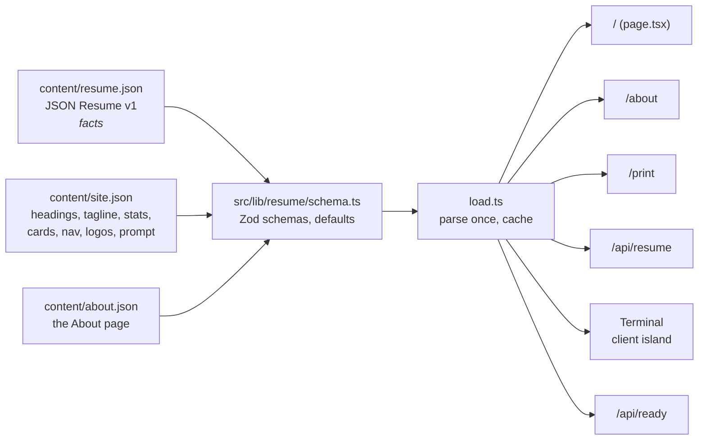
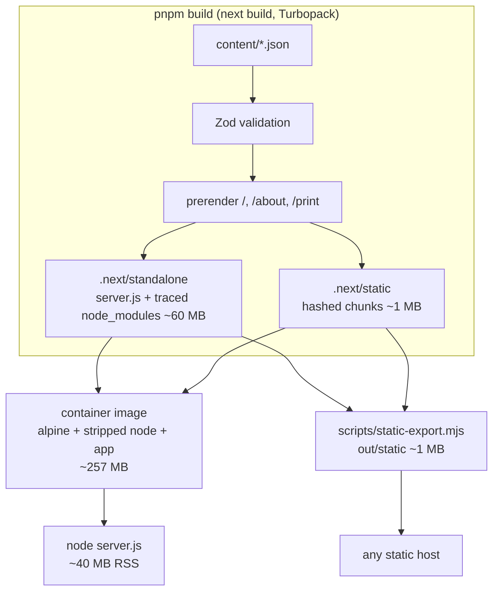

# Architecture

Promptfolio is one JSON document rendered four ways by one small Node process,
or by no process at all. This page explains the moving parts, the constraints
that shaped them, and what changes between deployment targets.

## The one-paragraph version

`content/resume.json` (standard [JSON Resume](https://jsonresume.org/schema))
and two presentation files are validated with Zod at build time and bundled
into a Next.js app. Every page is prerendered, so at runtime the server mostly
hands out files it already has; the only request-time code is two probe
routes. The site ships as a ~257 MB non-root container that idles at ~40 MB of
memory, or as ~1 MB of static files.

## Routes

| Route         | Kind                 | What it serves                                               |
| ------------- | -------------------- | ------------------------------------------------------------ |
| `/`           | prerendered page     | the site: hero, terminal, sections                           |
| `/about`      | prerendered page     | the longer narrative from `content/about.json`               |
| `/print`      | prerendered page     | single-column, ink-friendly view for "Save as PDF"           |
| `/api/resume` | route handler        | the resume as a JSON Resume document (5-minute cache)        |
| `/api/health` | route handler (live) | liveness: uptime, version, commit; `Cache-Control: no-store` |
| `/api/ready`  | route handler (live) | readiness: re-validates the content, `503` if it fails       |

## Content model



Three rules keep this honest:

1. **Resume facts stay portable.** `resume.json` must validate against the
   public JSON Resume schema. Anything site-specific (which logo goes with
   which employer, the hero stats, the nav) lives in `site.json`, never in
   invented resume keys. Unknown keys are preserved (`looseObject`) so a
   document round-trips, but only typed fields are rendered.
2. **Every field has a default.** `siteSchema` and `aboutSchema` default
   everything, so a fork can delete most of `site.json` and still build.
3. **Validation runs once and fails loudly.** The JSON files are imported as
   modules, so Turbopack bundles them and a syntax error fails the build.
   `loadContent()` parses with Zod once per process and caches; a schema error
   fails the build too (pages render at build time), and `/api/ready` re-checks
   so an orchestrator sees `503` rather than a broken page.

## Rendering model

```mermaid
sequenceDiagram
  participant B as Browser
  participant N as node server.js
  participant FS as prerendered HTML + RSC
  B->>N: GET /
  N->>FS: read index.html (built at image build time)
  FS-->>B: HTML (hero, sections, terminal shell)
  B->>N: GET /_next/static/chunks/*.js
  N-->>B: hashed, immutable assets
  Note over B: Terminal hydrates: typed boot, commands, settings
  B->>N: GET /api/ready (orchestrator)
  N->>N: await connection(); loadContent()
  N-->>B: 200 {status: ready} | 503
```

- **Cache Components.** `next.config.ts` enables `cacheComponents`, so pages
  are prerendered and nothing in a Server Component may depend on the
  request: no `new Date()`, no `Math.random()`, no headers or cookies. That
  constraint is why `/api/health` and `/api/ready` call `await connection()`
  first — it opts those two handlers into request-time execution.
- **One client island.** The terminal is the only Client Component with
  state. It receives the already-validated resume, site config and About
  document as props, so it can never disagree with the page. Its command
  engine, `src/components/terminal/commands.ts`, is pure (no DOM, no
  network), returns output lines plus an optional `Action`, and is
  unit-tested; `Terminal.tsx` executes the actions (scroll, navigate, open,
  clear). The Settings tab stores per-browser preferences in `localStorage`
  under `promptfolio.settings`, guarded so a blocked store changes nothing.
- **The aurora** is a fixed CSS layer in the root layout: three gradient
  "curtains" animated with `transform` and a brightness filter only, so the
  compositor does the work; it is static under `prefers-reduced-motion` and
  hidden in print. Settings can turn it off (`html[data-aurora="off"]`).
- **Print** is the same data through a plain, single-column page with its
  own `@media print` tokens; `.no-print` hides chrome.

## Build pipeline



- `output: "standalone"` makes Next.js trace exactly the files `server.js`
  needs, which is why the app layer is ~60 MB instead of a full
  `node_modules`.
- The Dockerfile has four stages: `base` (Node + pnpm), `deps` (frozen
  lockfile install with a cache mount), `build`, `nodebin` (strips debug
  symbols from the Node binary), and a `runtime` stage on bare Alpine that
  receives only the stripped binary, two libraries and the build output.
  Deleting files in a later layer never shrinks an image, which is why the
  runtime starts from scratch rather than from `node:22-alpine`.
- `scripts/static-export.mjs` rewrites the prerendered HTML so assets resolve
  relative to the page (Next emits absolute `/_next/` paths and the Turbopack
  runtime strips a base path from each script's `src`), copies `public/`,
  and writes `resume.json` in place of the API. The result works from a
  sub-path such as `https://you.github.io/resume/`.

## Runtime

- **Process.** `node server.js`, `PORT=3000`, `HOSTNAME=0.0.0.0`, no
  environment required. Build args `APP_VERSION` and `GIT_SHA` are baked in
  and surfaced by `/api/health` so a running copy can be matched to a commit.
- **Footprint.** ~40 MB RSS at rest, well under 50 MB under light load; the
  Compose and Kubernetes manifests cap memory at 128 Mi / 256 Mi and request
  50m CPU. Cold start is about one second.
- **State.** None. No database, no writes, no sessions. The only writable
  path the container needs is `/tmp` (tmpfs); the root filesystem is
  read-only in every provided manifest.
- **Logs.** Next.js writes request and error logs to stdout; collect them
  with whatever your platform already uses for containers.

## Security posture

- Non-root (`app`, uid 100), read-only root filesystem, all capabilities
  dropped, `no-new-privileges`, PID limit, memory limit — in `docker-compose.yml`
  and `deploy/kubernetes/`.
- No shell is needed at runtime; the health probe is a Node script.
- Security headers from `next.config.ts`: `X-Content-Type-Options: nosniff`,
  `X-Frame-Options: DENY`, `Referrer-Policy: strict-origin-when-cross-origin`,
  a restrictive `Permissions-Policy`, and no `X-Powered-By`. A Content
  Security Policy is a known follow-up: a nonce-based CSP would force
  per-request rendering, which conflicts with prerendering.
- No third-party requests at runtime: fonts are self-hosted via
  `@fontsource-variable`, icons are inline SVG.
- Supply chain: CI runs gitleaks; releases are multi-arch with an SBOM, SLSA
  provenance and a keyless cosign signature; Renovate keeps dependencies,
  actions and base images current.
- Details and the reporting policy: [SECURITY.md](../SECURITY.md).

## Design system

Tokens live in `src/app/globals.css` and reach Tailwind through
`@theme inline`. The look follows Tabby: navy canvas, Source Sans 3 light
display type, a frosted-glass terminal (`.glass`), an angled colour band behind
the hero (`.hero-band`), the aurora, and card/chip/button primitives. The nav is
deliberately in the terminal's idiom (monospace, prompt markers, square
actions). Everything below the hero is centered; long lists stay left-aligned
inside a centered block.

## What changes per deployment target

| Target                       | Process          | Probes             | TLS / domain           | Where it is documented      |
| ---------------------------- | ---------------- | ------------------ | ---------------------- | --------------------------- |
| Static host                  | none             | none               | the host's             | DEPLOYMENT.md, SELF-HOSTING |
| Docker / Podman on one box   | `node server.js` | Docker HEALTHCHECK | reverse proxy          | DEPLOYMENT.md, SELF-HOSTING |
| Kubernetes                   | 2 replicas       | HTTP probes        | Ingress + cert-manager | DEPLOYMENT.md               |
| Cloud Run / App Runner / Fly | managed          | HTTP probes        | managed                | deploy/gcp, deploy/aws      |

The application is identical in all of them; only the manifests differ.

## Why these choices

- **Next.js over a static generator**: route handlers, probes and the option
  of live sections want a server, and the static export covers the case
  where you do not.
- **JSON Resume over a bespoke schema**: portability and an existing
  ecosystem (themes, CLIs, importers all read `/api/resume`).
- **No UI library**: the aesthetic is specific and the surface area is small.
- **Self-hosted fonts and inline icons**: no third-party requests at runtime,
  nothing to consent to, nothing to go down.
- **A pure command engine**: the terminal is the feature people remember, so
  it is the part with the most tests.
